I build secure, observable cloud platforms, and I'm now extending them to AI/ML workloads.

📍 Nabeul, Tunisia &nbsp;·&nbsp; 🌍 Open to remote roles (EU & MENA)

## 👋 About me

I'm a Cloud & DevOps engineer and the founder of **Future Eagle IoT**, where I run the Kubernetes platforms, CI/CD and monitoring behind our multi-tenant SaaS and industrial IoT products.

- **Background:** I trained as a civil engineer, then moved into software in 2023. The habit carried over: systems fail at the assumption nobody checked.
- **What I do:** infrastructure as code with Terraform and Ansible, Kubernetes with Helm and ArgoCD, CI/CD with security scanning in every pipeline, and monitoring with Prometheus, Grafana and ELK.
- **Current focus:** AI/ML infrastructure. I run agents, RAG pipelines and model serving with the same rigor as any other production service.
- **Writing:** long-form notes on DevOps, DevSecOps, Cloud and MLOps on [my blog](https://ibrahimelothmani-blog.netlify.app/), including the *Engineering AI* and *TicketForge* series.

## 💼 Experience

**Cloud & DevOps Engineer · Future Eagle IoT** — *Dec 2025 – present · Nabeul, Tunisia (hybrid)*

- Cut CI/CD cycle time by ~40% with GitHub Actions pipelines and tighter promotion gates.
- Reduced Terraform/Ansible provisioning from ~2 days to ~30 minutes for repeatable multi-cloud infrastructure.
- Run Kubernetes platforms at 99.9% uptime with Helm releases and ArgoCD GitOps.
- Reduced mean time to detect (MTTD) by ~65% with Prometheus, Grafana and ELK.
- Added SonarQube quality gates and Trivy image scans to every pipeline.
- Products (private repos): **Future Eagle Fleet**, a multi-tenant fleet SaaS (Spring Boot, PostgreSQL RLS, Keycloak), and **Eagle IoT**, an industrial data pipeline (PLC → ESP32 → Kafka → TimescaleDB).

**Full Stack Engineer · Freelance** — *Jun 2024 – Nov 2025 · Remote*

- Delivered 6+ client products, each in under 8 weeks: APIs, SPAs and deployment packages.
- Implemented Keycloak OAuth2/JWT authentication, cutting login latency by ~40%.
- Cut hosting costs by ~35% by right-sizing Docker/Kubernetes footprints and CI usage.
- Used PostgreSQL row-level security to isolate tenant data on shared databases.

## 🚀 Featured projects

| Project | What it does | Stack |
|---|---|---|
| [**StackMedic**](https://github.com/ibrahimelothmani/StackMedic) | Local-first DevOps diagnostics toolkit that turns infrastructure failures into evidence-backed findings and safe, verifiable fixes. | Go · Docker · Kubernetes |
| [**AgentWarden**](https://github.com/ibrahimelothmani/AgentWarden) | Guardrail between autonomous AI coding agents and production repos: static analysis, sandboxed execution and policy checks reject unsafe changes before they land. | Go · Docker |
| [**FlexTier**](https://github.com/ibrahimelothmani/FlexTier-DevSecOps-Dual-Architecture-Java-Application-Orchestration-FinOps-on-AWS) | Moves a legacy Java WAR onto two targets, a low-cost K3s node and a Multi-AZ ECS Fargate stack, with FinOps tagging to compare real costs. | Java · AWS ECS Fargate · K3s · Ansible |
| [**TicketForge**](https://github.com/ibrahimelothmani/ticket-forge-devops) | Event-driven microservices platform that simulates flash-sale ticketing traffic to test scale, concurrency and resilience. | Python · FastAPI · Kafka · Terraform · EKS · ArgoCD |
| [**Cloud-Native MERN**](https://github.com/ibrahimelothmani/Cloud-Native-MERN-DevOps-Deployment) | MERN e-commerce app on Kubernetes with Helm, Jenkins CI/CD, and Prometheus/Grafana monitoring and alerting. | MERN · Kubernetes · Helm · Jenkins |
| [**Blog Platform CloudOps**](https://github.com/ibrahimelothmani/Blog-Platform-CloudOps) | Spring Boot + React app with Docker, Jenkins, Kubernetes, Terraform, Ansible, Prometheus and Grafana wired in from the first commit. | Spring Boot · React · Terraform · EKS |

**More:** [GitOps with ArgoCD](https://github.com/ibrahimelothmani/GitOps-on-k8s-using-ArgoCD) · [MLOps on Kubernetes](https://github.com/ibrahimelothmani/MLOps-Project-From-Model-Training-to-Kubernetes-Deployment) · [AI security scanner for S3](https://github.com/ibrahimelothmani/AI-Security-Scanner-for-AWS-S3) · [ProMonitor](https://github.com/ibrahimelothmani/ProMonitor) · [DBPulse](https://github.com/ibrahimelothmani/DBPulse---Database-Monitoring-Visualization-Platform) · [Jenkins SSO with Keycloak](https://github.com/ibrahimelothmani/Jenkins-Single-Sign-On-SSO-with-Keycloak-using-OpenID-Connect) · [LinuxQuest](https://github.com/ibrahimelothmani/-LinuxQuest)

## 🛠️ Tech stack

| Area | Stack |
|---|---|
| ☁️ **Cloud** |  AWS (EKS, ECS Fargate, EC2, Lambda, S3) · Azure |
| 🏗️ **Infrastructure as code** |  Terraform · Ansible · Helm |
| 🐳 **Containers & orchestration** |  Docker · Kubernetes · K3s · Linux |
| 🔁 **CI/CD & DevSecOps** |  GitHub Actions · Jenkins · ArgoCD (GitOps) · SonarQube · Trivy |
| 📈 **Observability** |  Prometheus · Grafana · Alertmanager · ELK |
| 💻 **Languages** |  Go · Java · Python · TypeScript · JavaScript · Bash |
| 🧩 **Frameworks & identity** |  Spring Boot · FastAPI · React · Angular · Keycloak (OAuth2 / OIDC) |
| 🗄️ **Data & messaging** |  PostgreSQL (row-level security) · Redis · Kafka · MongoDB · TimescaleDB |
| 🤖 **AI / ML** |  LangChain · RAG · pgvector · scikit-learn · LLM APIs (Claude, Gemini) |

## 🎓 Certificates & education

- **The Linux Foundation** (verified on Credly): [Introduction to Kubernetes (LFS158)](https://www.credly.com/badges/fd589dec-76d7-4867-8380-21de5ab5005a/public_url) · [Introduction to GitOps (LFS169)](https://www.credly.com/badges/04dd8eab-7cc1-491b-ae77-d34974de6002/public_url) · [Introduction to Linux (LFS101)](https://www.credly.com/badges/780fd237-a048-4cd7-84d3-e8d559e4e4ba/public_url)
- **Next:** AWS Certified Solutions Architect – Associate · Certified Kubernetes Administrator (CKA) · HashiCorp Terraform Associate
- **2i Formation:** Specialized Engineering Program, Full-Stack & DevOps Engineering (2023–2024)
- **ISET Nabeul:** Applied Bachelor's Degree in Civil Engineering, with honors (2017–2020)

---

**Open to remote Cloud & DevOps roles in the EU and MENA.** The fastest way to reach me is [email](mailto:ibrahimelothmanii@gmail.com) or [LinkedIn](https://www.linkedin.com/in/ibrahimelothmani/).

